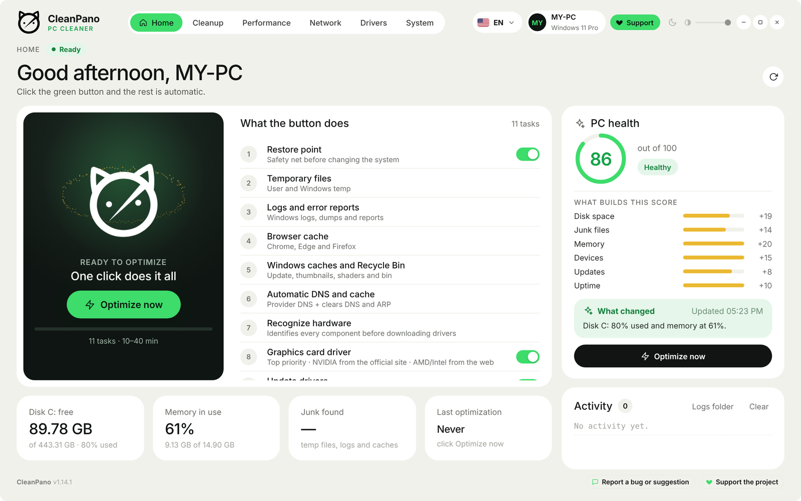
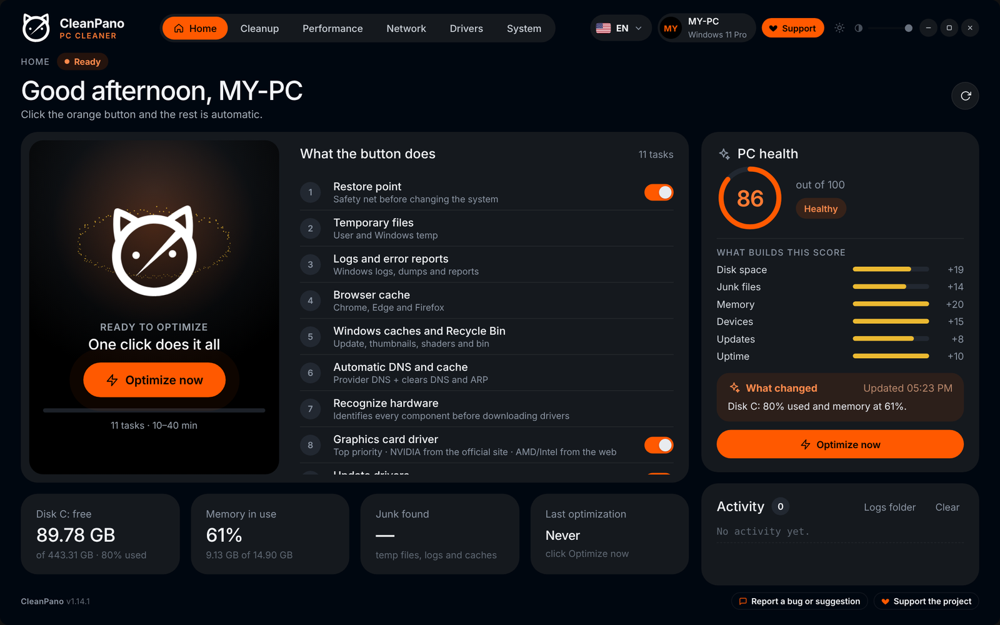
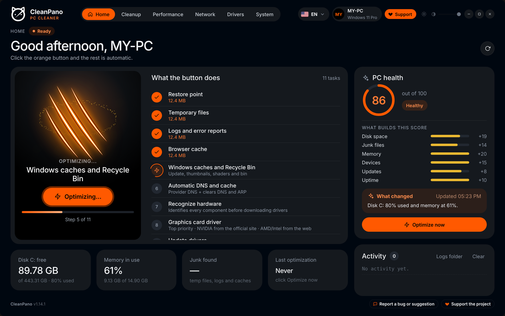
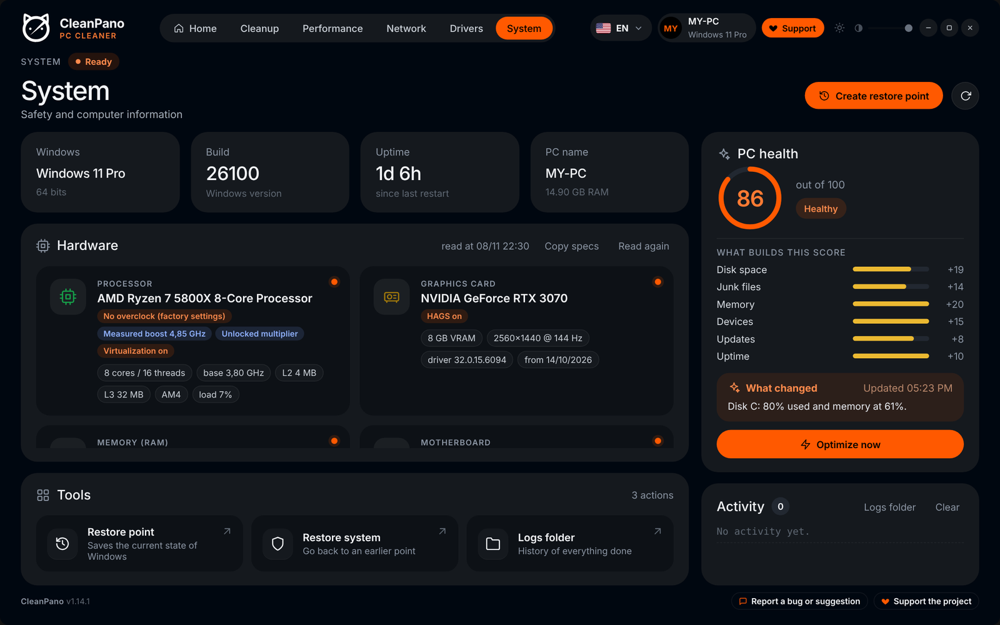

  

<h1 align="center">CleanPano</h1>

  <b>Free PC cleaning and optimization for Windows, in one click.</b> 
  Windows 10 and 11 (64-bit)

  <a href="https://github.com/CleanPano/CleanPano/releases/latest/download/CleanPano-Setup.exe"><b>⬇ Download CleanPano-Setup.exe</b></a>
  &nbsp;·&nbsp;
  <a href="https://github.com/CleanPano/CleanPano/releases">All versions</a>
  &nbsp;·&nbsp;
  <a href="https://x.com/CleanPano">Follow on X</a>

  
  

---

## English

### What it does

Press **Optimize now** and CleanPano runs everything in order:

- Creates a restore point before touching the system
- Cleans temporary files, error logs and dumps
- Clears Chrome, Edge and Firefox caches
- Empties Windows caches (update, thumbnails, shaders) and the Recycle Bin
- Sets DNS back to automatic and flushes the DNS and ARP caches
- Checks for a newer graphics driver (NVIDIA from the official site)
- Updates other drivers from the Microsoft Update Catalog
- Updates installed programs through winget
- Runs the Windows component cleanup (DISM)

There is also:

- **Performance:** turn off third-party programs that start with Windows, and repair Windows (DISM + SFC)
- **Network:** IP and network details, ping and speed tests, switch DNS between Cloudflare, Google and automatic
- **System:** hardware details for enthusiasts, such as dual channel memory and CPU overclock compared with factory specs
- **PC health score**, light and dark themes, 20 languages, and an option to optimize automatically when Windows starts

  
  

### How to install

1. Download **CleanPano-Setup.exe** from the link above.
2. Open the file.
3. If the blue screen "Windows protected your PC" appears, click **More info** and then **Run anyway**. The warning appears because the program is new and does not have a digital signature yet.
4. Click **Yes** when Windows asks for administrator permission.
5. Choose your language and follow the screens until **Finish**.

To remove: Windows Settings > Apps > CleanPano > Uninstall.

### Feedback and support

Found a problem or have an idea? Use **Report a bug or suggestion** in the app footer.

CleanPano is free. If it helped you, **Support the project** in the app shows a Bitcoin address for optional donations.

News and updates: [@CleanPano on X](https://x.com/CleanPano).

---

## Español

**Limpieza y optimización de PC para Windows, gratis y en un clic.** Para Windows 10 y 11 (64 bits).

1. Descarga **CleanPano-Setup.exe** con el enlace de arriba y ábrelo.
2. Si aparece la pantalla azul "Windows protegió su PC", haz clic en **Más información** y luego en **Ejecutar de todas formas**. El aviso aparece porque el programa es nuevo y todavía no tiene firma digital.
3. Acepta el permiso de administrador, elige el idioma y sigue las pantallas.

Después, abre CleanPano y haz clic en **Optimizar ahora**. Para errores o ideas, usa **Reportar error o sugerencia** en el pie de la app.

---

## Português (Brasil)

**Limpeza e otimização de PC para Windows, grátis e em um clique.** Para Windows 10 e 11 (64 bits).

1. Baixe o **CleanPano-Setup.exe** pelo link no topo e abra o arquivo.
2. Se aparecer a tela azul "O Windows protegeu o computador", clique em **Mais informações** e depois em **Executar assim mesmo**. O aviso aparece porque o programa é novo e ainda não tem assinatura digital.
3. Aceite a permissão de administrador, escolha o idioma e siga as telas.

Depois, abra o CleanPano e clique em **Otimizar agora**. Para bugs ou ideias, use **Reportar bug ou sugestão** no rodapé do app.
